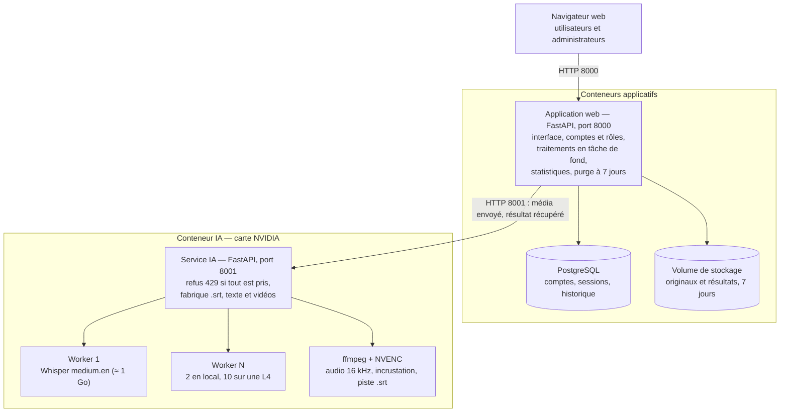
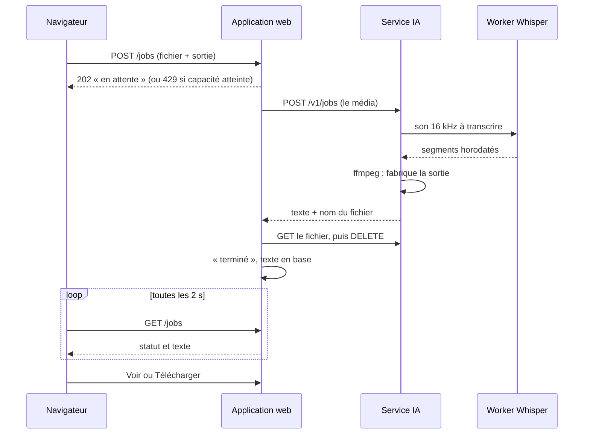
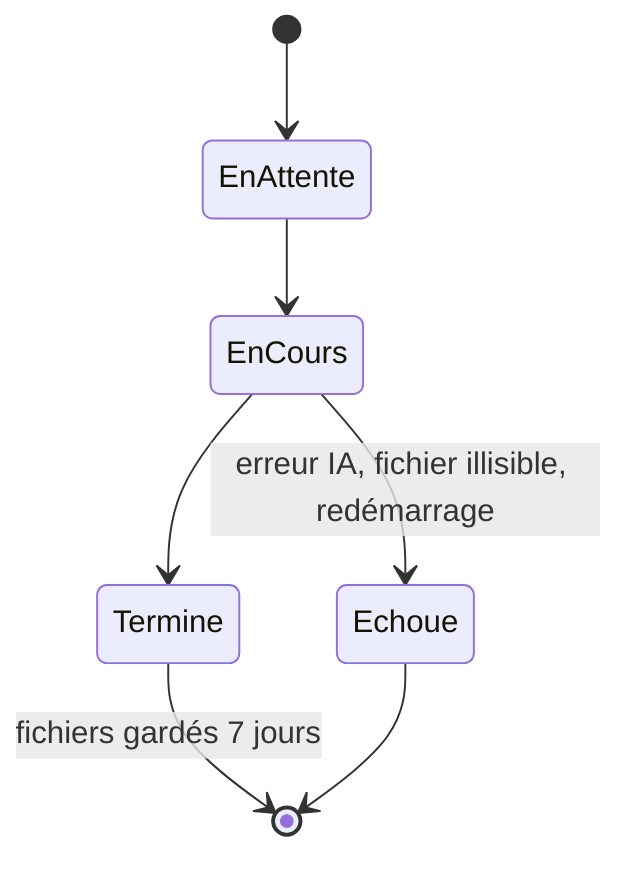
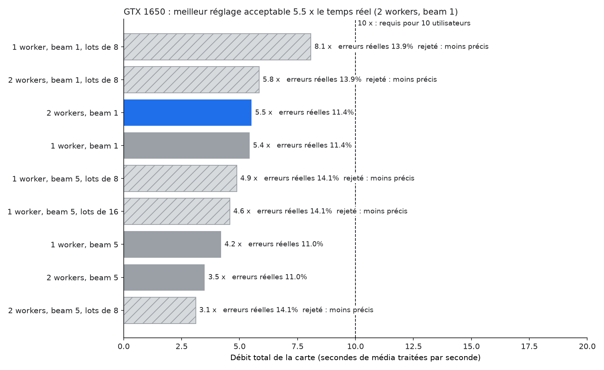
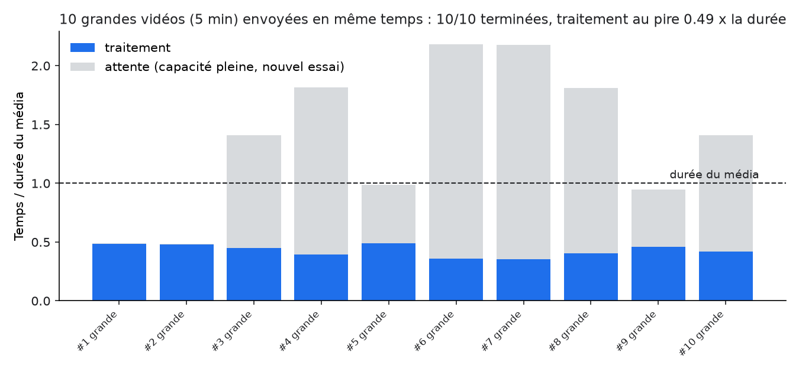
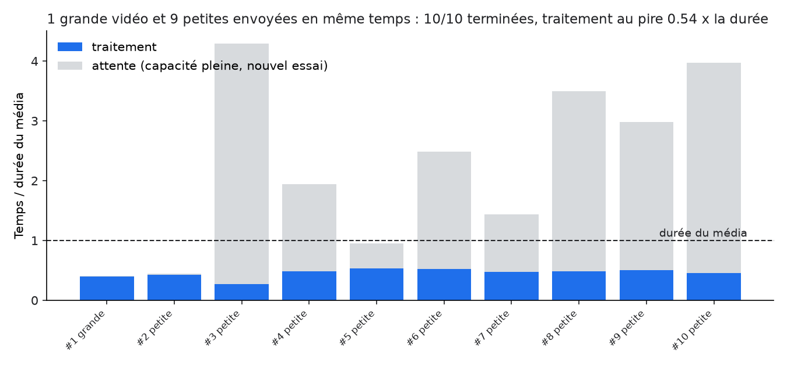
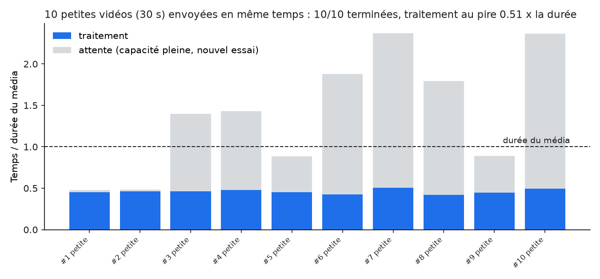

# Documentation du projet — Sous-titrage par IA

Projet fil rouge « data indus 26 » : industrialiser le pipeline de sous-titrage Whisper du data scientist.
Le produit fonctionne de bout en bout dans Docker : un utilisateur envoie une vidéo, Whisper la transcrit
sur carte graphique en moins de 0,55 fois sa durée, il récupère sa vidéo sous-titrée. Performances mesurées,
optimisées et extrapolées à 10 utilisateurs ; coût estimé sous le budget. Il reste la soutenance et les bonus.

- Installation : [INSTALL.md](INSTALL.md)
- Détails de chaque service : [subtitle_app/README.md](subtitle_app/README.md), [ai_service/README.md](ai_service/README.md)

## Sommaire

1. [Vue d'ensemble](#1-vue-densemble)
2. [Architecture](#2-architecture)
3. [Plan fonctionnel](#3-plan-fonctionnel)
4. [Parcours d'un traitement](#4-parcours-dun-traitement)
5. [Service IA](#5-service-ia)
6. [Données](#6-données)
7. [API](#7-api)
8. [Déploiement Docker](#8-déploiement-docker)
9. [Organisation du code](#9-organisation-du-code)
10. [Développement local et tests](#10-développement-local-et-tests)
11. [Mesures](#11-mesures)
12. [Dépannage](#12-dépannage)
13. [Décisions et feuille de route](#13-décisions-et-feuille-de-route)

## 1. Vue d'ensemble

**Le besoin** : sous-titrer des vidéos sans les confier à un fournisseur externe (souveraineté),
pour les malentendants, les comptes rendus de réunion et la traduction.

**Le produit** : une application web où l'on envoie un `.mp4` ou un `.wav` et où l'on choisit une sortie
parmi quatre. Un administrateur suit l'usage grâce à des statistiques.

**Contraintes** :

- traitement plus court que la durée du média (échantillon `input.mp4` : 148,9 s) ;
- tenue avec 10 utilisateurs en parallèle, sans file d'attente ;
- coût d'infrastructure de 10 000 € par an au maximum ;
- fichiers utilisateur supprimés après 7 jours, historique admin conservé.

**État d'avancement** :

| Brique | État |
| --- | --- |
| Application web : comptes, upload, 4 sorties, admin, purge | Terminée, 37 tests |
| Service IA : Whisper sur GPU, workers, NVENC, reprise après panne | Terminé, 25 tests |
| Docker Compose : application, PostgreSQL, service IA ; manuel d'installation | Terminé, testé sur poste avec GPU |
| Mesures, optimisation (9 réglages), 3 scénarios de charge, extrapolation L4 | Terminé |
| WER, coût annuel | Terminé |
| Bonus (traduction, locuteurs), slides, démo | À faire |

## 2. Architecture

Deux applications séparées : une application web sans IA, et un service IA qui seul utilise la carte
graphique. Le navigateur ne parle qu'à l'application ; le service IA n'est pas joignable de l'extérieur.



Le nombre de workers fixe le nombre de traitements simultanés ; l'application refuse les demandes
au-delà (`MAX_CONCURRENT_JOBS` = `NUM_WORKERS`).

## 3. Plan fonctionnel

### Rôles

| Rôle | Ce qu'il fait | Comment il obtient ce rôle |
| --- | --- | --- |
| Utilisateur | Envoie ses fichiers, choisit la sortie, consulte et télécharge ses résultats, supprime ses fichiers | Inscription libre |
| Administrateur | Tout ce que fait l'utilisateur, plus les statistiques, l'historique complet, la gestion des comptes | Compte créé au démarrage (`.env`) ou par un autre admin |
| Data scientist | Change de modèle ou ajoute une fonction (locuteurs, traduction) | `WHISPER_MODEL`, module `ai_service/app/transcriber.py` |

### Sortie possible selon l'entrée

| Fichier envoyé | Vidéo, sous-titres incrustés | Vidéo + piste de sous-titres | Sous-titres seuls (.srt) | Texte seul |
| --- | --- | --- | --- | --- |
| Vidéo `.mp4` | Oui | Oui | Oui | Oui |
| Audio `.wav` | Refusé | Refusé | Oui | Oui |

### Exigences et réalisation

| Exigence du cahier des charges | Réalisation | État |
| --- | --- | --- |
| Admin : installer en suivant la documentation | `INSTALL.md`, `docker compose up -d --build` | Fait |
| Admin : arrêter la solution | `docker compose stop` | Fait |
| Admin : relancer après arrêt ou crash | `restart: unless-stopped` ; traitements interrompus marqués « échoués » ; worker IA recréé et traitement retenté | Fait, testé |
| Admin : statistiques (temps moyen, inférences, non terminés, échoués, par type, contenu) | Onglet admin, `GET /api/v1/admin/stats` | Fait |
| Utilisateur : envoyer un `.mp4` ou un `.wav` | Upload par morceaux, jusqu'à 4 Go | Fait |
| Utilisateur : choisir la sortie selon le tableau | 4 sorties, combinaisons interdites refusées | Fait |
| Utilisateur : lancer puis télécharger | Traitement en fond, bouton « Télécharger » | Fait |
| Data scientist : changer de modèle, ajouter une fonction | Modèle réglable, transcription isolée dans un module | Fait |
| Optionnel : consulter sans télécharger | Bouton « Voir » : texte, .srt, lecteur vidéo | Fait |
| Optionnel : brancher la traduction | Texte disponible par l'API ; traduction en bonus | À faire |
| Performance : plus rapide que la durée du média | Traitement en 0,27 à 0,54 fois la durée (mesuré) | Fait |
| Performance : 10 utilisateurs en parallèle | 3 scénarios de charge mesurés ; extrapolation L4 : ≈ 0,79 fois la durée | Fait (estimé pour la L4) |
| Coût : 10 000 € par an au maximum | 7 140 à 7 490 € HT/an en 24h/24, 2 520 à 2 620 € en heures ouvrées | Fait (estimé) |

### Règles validées avec le product owner

- Transcription en anglais ; traduction en bonus.
- Pas de file d'attente : au-delà de la capacité, refus immédiat avec un message clair.
- Fichiers supprimés après 7 jours, ou avant par l'utilisateur ; l'historique et le texte restent.
- L'inscription crée toujours un simple utilisateur ; seul un admin crée un admin.

## 4. Parcours d'un traitement

L'application répond tout de suite, traite en fond, et l'interface affiche le résultat dès qu'il est prêt.





Toute erreur pendant le traitement le fait passer à « échoué » avec son message, visible par l'admin.

## 5. Service IA

Le service garde N copies du modèle Whisper chargées en permanence, une par worker (option A validée
avec le conseiller technique), et refuse une demande quand elles sont toutes occupées.

**Workers**

- Un worker est un processus séparé avec sa copie de `medium.en` compressé (`int8_float16`, ≈ 1 Go de mémoire GPU).
- Les modèles sont chargés au démarrage ; le service n'accepte rien avant.
- `NUM_WORKERS` : 2 sur une carte de 4 Go, 10 prévus sur une L4 (24 Go).
- Si un worker meurt (mémoire saturée…), le groupe est recréé et le traitement retenté une fois ;
  un média qui fait planter le worker deux fois échoue.

**Étapes d'un traitement**

1. Réception du fichier, écrit sur disque par morceaux.
2. Extraction du son par ffmpeg (mono, 16 kHz).
3. Transcription par Whisper dans un worker libre : segments (début, fin, texte).
4. Fabrication du `.srt` et du texte.
5. Fabrication de la sortie demandée.
6. Réponse à l'application, qui télécharge le fichier puis demande sa suppression.

**Sorties**

| Sortie | Fichier | Méthode | Temps (149 s de vidéo) |
| --- | --- | --- | --- |
| Texte seul | `transcript.txt` | Segments mis bout à bout | Négligeable |
| Sous-titres seuls | `subtitles.srt` | Format SRT standard (`00:01:05,000`) | Négligeable |
| Vidéo + piste | `video_piste_sous_titres.mp4` | Piste `mov_text` ajoutée sans réencodage | < 1 s |
| Vidéo incrustée | `video_sous_titree.mp4` | Sous-titres dessinés dans l'image, encodage NVENC (repli `libx264`) | ≈ 5 s |

**Choix techniques**

- faster-whisper plutôt que `transformers` (prototype) : même modèle, compressé et plus rapide.
- Audio lu par ffmpeg plutôt que par PyAV, dont une mise à jour a cassé le décodage.
- NVENC encode sur la puce vidéo de la carte, sans prendre de calcul à Whisper.
- Résultats non récupérés effacés après 24 h (`RESULT_TTL_HOURS`).

## 6. Données

| Table | Une ligne = | Colonnes principales |
| --- | --- | --- |
| `users` | un compte | nom unique, mot de passe haché (PBKDF2-SHA256 salé), rôle `user` ou `admin` |
| `auth_tokens` | une session | jeton aléatoire, compte, expiration (12 h) |
| `jobs` | un traitement | fichier d'origine, types d'entrée et de sortie, statut, dates, durée du média, temps de traitement, texte, erreur, chemins, « fichiers supprimés » |

Les statistiques sont calculées à la demande depuis `jobs`. Une ligne `jobs` n'est jamais supprimée.

| Donnée | Avec Docker | En développement local |
| --- | --- | --- |
| Base | PostgreSQL, volume `pgdata` | SQLite, `subtitle_app/data/app.db` |
| Fichiers envoyés et résultats | Volume `storage` | `subtitle_app/data/storage/` |
| Copies temporaires du service IA | Conteneur `ai`, effacées après récupération | `ai_service/work/` |
| Modèle Whisper (≈ 1,5 Go) | Volume `models` | Cache Hugging Face de l'utilisateur |

**Conservation** : fichiers 7 jours (`RETENTION_DAYS`, purge toutes les heures) ; historique sans limite ;
sessions 12 h.

## 7. API

Documentation interactive : `/docs` de l'application.

### Application web (port 8000)

Toutes les routes sauf `register`, `login` et `/healthz` demandent `Authorization: Bearer <jeton>`.

| Route | Rôle | Accès |
| --- | --- | --- |
| `POST /api/v1/auth/register` | Créer un compte utilisateur | Public |
| `POST /api/v1/auth/login` | Se connecter | Public |
| `POST /api/v1/auth/logout` | Invalider son jeton | Connecté |
| `GET /api/v1/auth/me` | Son compte | Connecté |
| `POST /api/v1/jobs` | Envoyer `file` + `output_type` ; réponse 202 | Connecté |
| `GET /api/v1/jobs` | Ses traitements | Connecté |
| `GET /api/v1/jobs/{id}` | Détail avec le texte | Propriétaire ou admin |
| `GET /api/v1/jobs/{id}/result` | Télécharger le résultat | Propriétaire ou admin |
| `DELETE /api/v1/jobs/{id}/files` | Supprimer les fichiers (l'historique reste) | Propriétaire ou admin |
| `GET /api/v1/admin/stats` | Statistiques globales et par type | Admin |
| `GET /api/v1/admin/jobs` | Historique complet | Admin |
| `GET /api/v1/admin/users` | Liste des comptes | Admin |
| `POST /api/v1/admin/users` | Créer un compte, admin compris | Admin |
| `GET /healthz` | Supervision | Public |

### Service IA (port 8001, interne)

| Route | Rôle |
| --- | --- |
| `POST /v1/jobs` | Traite `file` + `output_type` ; répond à la fin avec `job_id`, `text`, `output_filename`, `media_duration_s`, `transcription_s`, `total_s`, `video_encoder` |
| `GET /v1/jobs/{id}/files/{nom}` | Télécharge le fichier produit (4 noms autorisés) |
| `DELETE /v1/jobs/{id}` | Efface les fichiers du traitement |
| `GET /healthz` | Modèle, workers, traitements en cours |

### Codes de réponse

| Code | Signification |
| --- | --- |
| 202 | Traitement accepté |
| 400 | Format non pris en charge, ou audio vers vidéo |
| 401 / 403 | Non connecté / non admin |
| 409 | Traitement pas terminé |
| 410 | Fichiers déjà supprimés |
| 413 | Fichier trop gros (4 Go) |
| 429 | Capacité atteinte, pas de file d'attente |
| 500 | Échec dans le service IA, message détaillé |

`output_type` : `video_embedded`, `video_metadata`, `subtitles`, `text`.

## 8. Déploiement Docker

La procédure complète est dans [INSTALL.md](INSTALL.md). En résumé :

```bash
cp .env.example .env              # puis changer les mots de passe
docker compose up -d --build      # installer et démarrer
docker compose stop               # arrêter
docker compose start              # relancer
```

| Conteneur | Image | Taille | Rôle |
| --- | --- | --- | --- |
| `app` | `python:3.12-slim` + application | 276 Mo | Interface et API, port publié (`APP_PORT`) |
| `db` | `postgres:16-alpine` | — | Base de données, non exposée |
| `ai` | `nvidia/cuda:12.4.1-cudnn-runtime-ubuntu22.04` + ffmpeg + faster-whisper | 6,8 Go | Service IA avec accès GPU et NVENC, non exposé |

- Redémarrage automatique (`restart: unless-stopped`) de chaque conteneur.
- L'application attend que la base et le service IA soient prêts (`healthcheck`).
- Données dans des volumes : `pgdata`, `storage`, `models`.
- Les conteneurs tournent avec un utilisateur sans droits d'administration.
- `docker-compose.cpu.yml` : variante sans carte NVIDIA (modèle `small.en` sur processeur, 1 worker).

**Pourquoi pas Kubernetes** : un seul serveur GPU et 10 utilisateurs fixés à l'avance ; Compose couvre
installer, arrêter et relancer. Kubernetes serait utile au-delà d'un serveur.

**Cloud** : la procédure de déploiement sur Scaleway L4 est décrite dans `INSTALL.md` mais n'a pas été
exécutée (pas de location de serveur) ; les performances cloud sont estimées.

## 9. Organisation du code

```text
subtitle-factory/
├── .gitignore, .gitattributes
└── projet fil rouge/
    ├── DOCUMENTATION.md, INSTALL.md
    ├── docker-compose.yml, docker-compose.cpu.yml, .env.example
    ├── test_pipeline_3.py        prototype d'origine fourni
    ├── real_subtitle.txt         référence pour le WER
    ├── input.mp4                 échantillon de 148,9 s (hors Git)
    ├── experiments/
    │   └── essai_whisper.py      mesure vitesse + WER
    ├── bench/
    │   ├── echantillons.py       petite et grande vidéos de test
    │   ├── charge.py             scénarios de charge, débit, WER
    │   ├── graphiques.py         graphiques des résultats
    │   └── resultats/            mesures (JSON) et graphiques (PNG)
    ├── subtitle_app/             APPLICATION WEB
    │   ├── Dockerfile
    │   ├── app/
    │   │   ├── main.py           création de l'application
    │   │   ├── core/             réglages, base, sécurité, démarrage
    │   │   ├── api/v1/           regroupement des routes
    │   │   ├── routers/          routes : auth, jobs, admin, healthz
    │   │   ├── services/         règles métier : traitements, stats, purge
    │   │   ├── cruds/            tables et requêtes
    │   │   ├── schemas/          formats d'entrée et de sortie
    │   │   └── ressources/       client du service IA (http) et simulation (fake)
    │   ├── frontend/             interface HTML, CSS, JS
    │   └── tests/                37 tests
    └── ai_service/               SERVICE IA
        ├── Dockerfile
        ├── app/
        │   ├── main.py           routes
        │   ├── config.py         réglages
        │   ├── transcriber.py    workers Whisper, reprise après panne
        │   ├── pipeline.py       transcription puis sortie
        │   ├── media.py          ffmpeg et NVENC
        │   └── subtitles.py      .srt et texte
        └── tests/                25 tests
```

| Je veux… | Fichier |
| --- | --- |
| Changer de modèle | `.env` : `WHISPER_MODEL` |
| Ajouter une étape (locuteurs, traduction) | `ai_service/app/transcriber.py`, `pipeline.py` |
| Changer l'encodage vidéo | `ai_service/app/media.py` |
| Ajouter une statistique | `subtitle_app/app/services/_stats.py`, `schemas/_stats.py` |
| Changer une règle (rétention, capacité) | `.env` |
| Modifier l'interface | `subtitle_app/frontend/` |
| Brancher une autre IA | `subtitle_app/app/ressources/_ai_client.py` |

## 10. Développement local et tests

Sans Docker, deux terminaux (Python 3.11+, ffmpeg ; sous Windows, `python -m pip install nvidia-cublas-cu12 "nvidia-cudnn-cu12==9.*"`) :

```powershell
cd "projet fil rouge\ai_service"
python -m pip install -r requirements.txt
python -m uvicorn app.main:app --port 8001
```

```powershell
cd "projet fil rouge\subtitle_app"
python -m pip install -r requirements.txt
$env:AI_BACKEND="http"; $env:MAX_CONCURRENT_JOBS="2"
python -m uvicorn app.main:app --port 8000
```

Sans carte graphique, seul le second suffit, sans la ligne `$env:` : l'IA est alors simulée.

**Tests** : `python -m pytest` dans chaque dossier. Base et dossiers temporaires, pas de GPU requis.

| Dossier | Tests | Couverture |
| --- | --- | --- |
| `subtitle_app/` | 37 | Comptes et rôles, upload et règles, capacité (y compris envois simultanés), purge, statistiques, client HTTP vers l'IA |
| `ai_service/` | 25 | Format SRT, ffmpeg réel, 4 sorties, refus 429, erreurs, suppression, reprise après mort d'un worker, options de décodage |

## 11. Mesures

Toutes les mesures se font sur le poste de développement (NVIDIA GTX 1650, 4 Go), dans Docker, à travers
l'application, avec `bench/charge.py`. Échantillon `input.mp4` : 148,9 s. Résultats bruts : `bench/resultats/`.

**En résumé** : avec le réglage retenu (2 workers, `beam 1`, sans mode par lots), chaque vidéo est transcrite en
**0,27 à 0,54 fois sa durée** sur la carte locale, et la carte traite **5,5 secondes de média par seconde**,
sans perte en passant de 1 à 2 workers. Extrapolé à une L4 : ≈ 12,7 × le temps réel, au-dessus des 10 ×
nécessaires pour 10 utilisateurs simultanés.

### Optimisation : 9 réglages comparés



| Réglage | Débit total | Erreurs réelles | Verdict |
| --- | --- | --- | --- |
| 2 workers, beam 5, lots de 8 | 3,1 × | 14,1 % | Rejeté : moins précis, lent à 2 workers |
| 2 workers, beam 5 (réglage initial) | 3,5 × | 11,0 % | Lent |
| 1 worker, beam 5 | 4,2 × | 11,0 % | |
| 1 worker, beam 5, lots de 16 | 4,6 × | 14,1 % | Rejeté : moins précis |
| 1 worker, beam 5, lots de 8 | 4,9 × | 14,1 % | Rejeté : moins précis |
| 1 worker, beam 1 | 5,4 × | 11,4 % | |
| **2 workers, beam 1** | **5,5 ×** | **11,4 %** | **Retenu** |
| 2 workers, beam 1, lots de 8 | 5,9 × | 13,9 % | Rejeté : moins précis, s'effondre à 2 workers |
| 1 worker, beam 1, lots de 8 | 8,1 × | 13,9 % | Rejeté : moins précis, s'effondre à 2 workers |

- **Débit total** : secondes de média traitées par seconde, tous traitements confondus.
- **Erreurs réelles** : mots faux + mots manqués, rapportés aux 483 mots de la référence. Le WER brut
  (34 à 40 %) compte aussi les mots prononcés que la référence TV a omis.
- **Constats** :
  1. `beam 1` est plus rapide que `beam 5` à qualité équivalente (11,4 % contre 11,0 %).
  2. Sans mode par lots, passer de 1 à 2 workers ne coûte rien (5,4 × puis 5,5 ×) : de bon augure pour
     10 workers sur une L4.
  3. Le mode par lots de faster-whisper ne produit par défaut que des blocs de 30 s : des sous-titres
     illisibles (jusqu'à 41 s affichés d'un coup). Corrigé en réactivant les horodatages ; il est alors moins
     précis (+ 25 % d'erreurs) et son débit s'effondre dès 2 workers. Écarté.

Réglage retenu, appliqué par défaut : `NUM_WORKERS=2`, `WHISPER_BEAM_SIZE=1`, `WHISPER_BATCH_SIZE=0`.

### Scénarios de charge (réglage retenu)

Dix utilisateurs envoient leur vidéo au même instant. La carte locale a deux places : les refusés (429)
réessaient toutes les 3 s, comme le ferait un utilisateur. Petite vidéo : 30 s ; grande : 297,8 s.

| Scénario | Terminés | Traitement / durée | Attente + traitement / durée (pire cas) | Débit total |
| --- | --- | --- | --- | --- |
| 10 petites vidéos | 10 / 10 | 0,42 à 0,51 | 2,37 | 4,1 × |
| 1 grande + 9 petites | 10 / 10 | 0,27 à 0,54 | 4,29 | 4,4 × |
| 10 grandes vidéos | 10 / 10 | 0,36 à 0,49 | 2,18 | 4,6 × |







Chaque traitement prend moins de 0,55 fois la durée de la vidéo. Sur la carte locale, avec deux places,
les derniers utilisateurs attendent : c'est la limite du matériel de développement. Sur la L4, les
10 traitements tournent ensemble et l'attente disparaît.

Ces tests ont aussi révélé un défaut, corrigé : pendant l'envoi d'une grande vidéo, d'autres demandes
pouvaient passer le contrôle de capacité. La place est désormais réservée avant l'envoi (test automatique
ajouté).

### Extrapolation à 10 utilisateurs sur une L4

Hypothèse prudente : l'écriture du texte par Whisper est limitée par la bande passante mémoire de la carte.

| Carte | Bande passante mémoire | Calcul FP16 |
| --- | --- | --- |
| GTX 1650 (poste local) | 128 Go/s | ≈ 6 TFLOPS, sans cœurs Tensor |
| L4 (Scaleway L4-1-24G) | 300 Go/s | 121 TFLOPS (Tensor, hors parcimonie) |
| Rapport retenu | **× 2,3** | × 20 (non retenu, trop optimiste) |

Sources : [NVIDIA L4](https://www.nvidia.com/en-us/data-center/l4/),
[Lenovo Press L4](https://lenovopress.lenovo.com/lp1717-nvidia-l4-24gb-pcie-gen4-passive-gpu),
[TechSpot GTX 1650](https://www.techspot.com/specs/gpu/198658-nvidia-geforce-gtx-1650-4gb.html),
[E2E Networks, Whisper sur L4](https://www.e2enetworks.com/blog/benchmarking-asr-models-nvidia-l4-parakeet-whisper-nemotron)
(la bande passante y est identifiée comme la limite).

10 utilisateurs envoyant chacun une vidéo de même durée : chaque traitement prend ≈ 10 ÷ débit fois la durée.

| Réglage | Débit local mesuré | Débit L4 estimé (× 2,3) | Traitement / durée, 10 simultanés | Tient l'exigence |
| --- | --- | --- | --- | --- |
| Réglage initial (2 workers, beam 5) | 3,5 × | 8,1 × | 1,24 | Non |
| Retenu (2 workers, beam 1) | 5,5 × | 12,7 × | 0,79 | Oui, marge ≈ 20 % |

Sur la L4, il faut 10 places pour respecter « pas de file d'attente » : `NUM_WORKERS=10` (≈ 1 Go par
modèle, 24 Go disponibles). Le débit retenu ne baisse pas de 1 à 2 workers sur la carte locale ; rien ne
garantit qu'il en soit de même à 10. Les scénarios de charge, qui incluent les envois et les pauses de
nouvel essai propres à la carte locale, donnent un débit plus bas (4,1 à 4,6 ×) : extrapolé tel quel, il
mènerait à ≈ 1,0. Avant une mise en production, une location de 2 h (≈ 1,50 €) avec
`bench/charge.py debit --users 10` trancherait.

### Coût annuel (Scaleway, Paris)

| Poste | Hypothèse | 24 h/24 | Heures ouvrées (10 h × 5 j) |
| --- | --- | --- | --- |
| Instance L4-1-24G | 0,75 à 0,79 € HT/h | 6 570 à 6 920 € | 1 950 à 2 050 € |
| Stockage bloc | 500 Go à 0,00013 € HT/Go/h | 570 € | 570 € |
| **Total HT** | | **7 140 à 7 490 €** | **2 520 à 2 620 €** |
| Total TTC (20 %) | | 8 570 à 8 990 € | 3 020 à 3 150 € |

Les deux options tiennent sous le plafond de 10 000 €/an, même TTC. Les heures ouvrées supposent
d'arrêter et relancer l'instance automatiquement. Sources :
[Scaleway L4](https://www.scaleway.com/en/l4-gpu-instance/),
[tarifs GPU](https://scaleway.com/en/pricing/gpu),
[tarifs stockage](https://www.scaleway.com/en/pricing/storage/).

### Qualité (WER)

Comparaison avec `real_subtitle.txt`, après minuscules et retrait de la ponctuation, des horodatages et des
noms d'intervenants (réglage retenu) :

| Mesure | Valeur |
| --- | --- |
| Mots de la référence | 483 |
| WER brut | 34,4 % |
| Erreurs réelles (mots faux + manqués) | 11,4 % |

La référence est un sous-titrage TV qui résume l'oral ; Whisper transcrit mot à mot. La plupart des
« erreurs » du WER brut sont des mots prononcés absents de la référence.

### Résilience (Docker)

| Test | Résultat |
| --- | --- |
| Application tuée en plein traitement | Relancée seule en 2 s ; traitement marqué « échoué » avec sa cause |
| Worker IA tué | Groupe recréé ; traitement suivant réussi |
| Arrêt puis relance de tout | Historique intact |

### Reproduire

```bash
python bench/echantillons.py                          # petite (30 s) et grande (5 min) vidéos
python bench/charge.py debit --users 1 --label essai   # débit et WER sur input.mp4
python bench/charge.py grandes --users 10 --label scen-10-grandes
python bench/graphiques.py                             # graphiques dans bench/resultats/
```

## 12. Dépannage

| Message | Cause | Solution |
| --- | --- | --- |
| `No module named 'app'` | Mauvais dossier | Se placer dans `subtitle_app/` ou `ai_service/` |
| `cannot import name 'mapped_column'` | SQLAlchemy 1.x installé | `python -m pip install -r requirements.txt`, ou un `.venv` |
| `No module named 'httpx'` (ou autre) | Plusieurs Python installés, `python` ne pointe pas sur celui qui a les bibliothèques | `py -0` pour lister, puis `py -3.13 -m …`, ou un `.venv` |
| `[Errno 13] … bind on address ('127.0.0.1', 8000)` | Port pris ou réservé par Windows | Autre port (`--port 8080` ou `APP_PORT`) ; diagnostic `netstat -ano \| findstr :8000` |
| `cublas64_12.dll is not found` | Bibliothèques CUDA absentes (hors Docker) | `python -m pip install nvidia-cublas-cu12 "nvidia-cudnn-cu12==9.*"` |
| `ffmpeg` introuvable | PATH pas à jour | Rouvrir le terminal et l'éditeur |
| Programme ou DLL bloqué par Windows | Contrôle d'application de Windows 11 | `python -m uvicorn` plutôt que `uvicorn` |
| `could not select device driver "nvidia"` | Docker ne voit pas la carte | Pilote et Docker Desktop à jour, ou NVIDIA Container Toolkit sous Linux |
| Conteneur arrêté par `docker kill` non relancé | Docker traite `kill` comme un arrêt volontaire | `docker compose start` ; la relance automatique vaut pour les vrais crashs |
| « Service IA injoignable » | Service IA arrêté ou mauvaise adresse | Vérifier `docker compose ps`, `AI_SERVICE_URL` |
| « Service IA saturé » | Capacité de l'application > workers IA | `MAX_CONCURRENT_JOBS` = `NUM_WORKERS` |
| Erreurs aléatoires sur les fichiers | Projet dans OneDrive | Déplacer le projet hors de OneDrive |

## 13. Décisions et feuille de route

### Décisions

| Sujet | Décision | Par | Raison |
| --- | --- | --- | --- |
| Langue | Anglais ; traduction en bonus | Product owner | Périmètre du prototype |
| Hébergeur cible | Cloud français (Scaleway ou OVH) | Product owner | Souveraineté |
| File d'attente | Aucune, refus au-delà de la capacité | Product owner | Réponse immédiate |
| Rétention | Fichiers 7 jours, historique permanent | Product owner | Vie privée et suivi |
| Inscription | Libre, rôle utilisateur | Équipe | Simplicité |
| Architecture | Application sans IA + service IA séparé | Conseiller technique | Isoler le GPU |
| Parallélisme | Une copie du modèle par worker ; 2 en local, 10 sur L4 | Conseiller technique, puis mesures | Sans perte de débit de 1 à 2 workers ; il faut 10 places sans file |
| Décodage | `beam 1`, sans mode par lots | Mesures | Plus rapide à qualité égale ; le mode par lots est moins précis et s'effondre à plusieurs workers |
| Encodage vidéo | NVENC dans le service IA | Conseiller technique | Ne pas ralentir Whisper |
| Orchestration | Docker Compose, pas Kubernetes | Équipe | Un seul serveur |
| Serveur cible | Scaleway L4-1-24G, 0,75 €/h HT (≈ 6 570 €/an 24h/24, ≈ 2 400 €/an heures de bureau) | Équipe | Sous le budget |
| Location du serveur | Non : mesures sur poste local, extrapolation | Équipe | Budget du projet |
| Moteur | faster-whisper, audio par ffmpeg | Équipe | Vitesse, fiabilité |
| Échanges de fichiers | HTTP entre application et service IA | Équipe | Simplicité |
| Triton Inference Server | Non retenu pour l'instant | Équipe | L'extrapolation tient sans lui ; piste si la mesure réelle sur L4 déçoit |

### Feuille de route

1. **Démo et répétition**, slides à rendre la veille avec le code et le manuel.
2. **Bonus** : traduction des sous-titres en français, puis identification des locuteurs si le temps le permet.
3. **Optionnel** : location de 2 h d'une L4 (≈ 1,50 €) pour confirmer l'extrapolation.

### Petites tâches

- [ ] Alléger la vidéo incrustée (44 Mo contre 15 Mo pour l'original) en réglant NVENC
- [ ] Vérifier la variante sans GPU (`docker-compose.cpu.yml`) sur un poste sans carte NVIDIA
